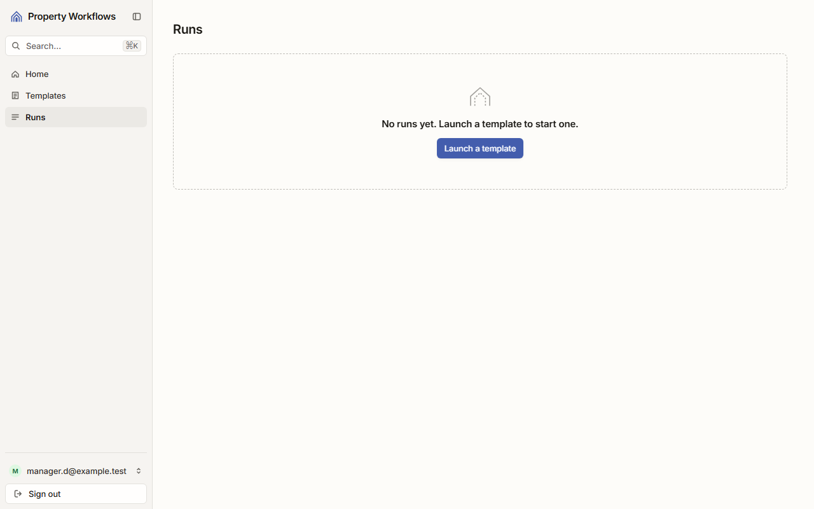
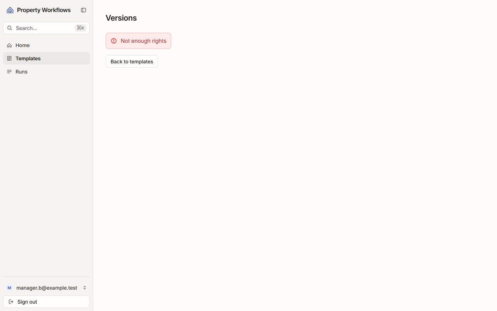
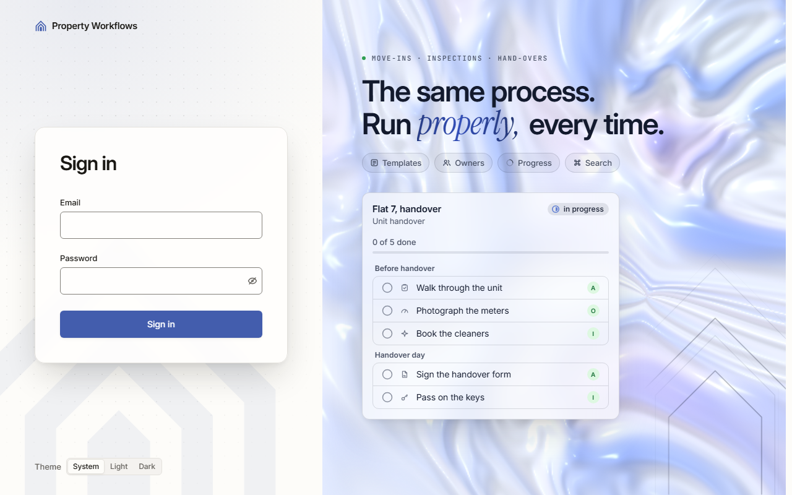

# Звіт UAT — 02.11.2026

- **Застосунок:** https://property-workflows-rho.vercel.app (/api/health: коміт `ac4da80`)
- **Код тестів:** `main` @ `ac4da80`
- **Прогін:** 02.11.2026, 13:52 (Київ), Playwright 33.3 с; AC: 3 — PASS 3, FAIL 0, NEEDS-HUMAN 0
- **Рецензент:** `claude-haiku-5-5`; суперечки → `claude-sonnet-5-5`. Разом за розбір: $0.0060 (ціни API; за підпискою — у межах ліміту плану)
- **Прибирання:** синтетичних uat-*@example.test видалено 0, лишилось 0, їхніх рядків, що лишились: 0
- **Відео й траси:** не в git — `test-results/` локально або артефакт CI; трасу відкриває `npx playwright show-trace <trace.zip>`

| AC | Перевірки | Агент | Підсумок | Чому | Playwright | Розбір |
|---|---|---|---|---|---|---|
| AC-DSYS-04 | пройшли | Haiku: PASS | **PASS** | R6: перевірки, агент і цитати збігаються | 3.9 с | $0.0020, 8.5 с |
| AC-EDITOR-07 | пройшли | Haiku: PASS | **PASS** | R6: перевірки, агент і цитати збігаються | 3.3 с | $0.0019, 7.7 с |
| AC-EDITOR-09 | пройшли | Haiku: PASS | **PASS** | R6: перевірки, агент і цитати збігаються | 10.9 с | $0.0022, 10.5 с |

## AC-DSYS-04 — PASS

**Тест:** AC-DSYS-04: менеджер без запусків відкриває список запусків — «No runs yet. Launch a template to start one.», посилання «Launch a template» і без таблиці

**Критерій** (requirements/19-use-one-design-system.md):

> AC-DSYS-04: Given manager B who has no runs. When B opens the list of runs. Then B sees the message "No runs yet. Launch a template to start one." and the link "Launch a template", and no empty table.

**Кроки:** ✔ Дано: менеджер B, у якого немає запусків → ✔ Коли: B відкриває список запусків → ✔ Тоді: B sees the message "No runs yet. Launch a template to start one." and the link "Launch a template", and no empty table.

**Агент (claude-haiku-5-5, PASS):** На кадрі frame-then-1.png (сторінка Runs) видно повідомлення «No runs yet. Launch a template to start one.» і під ним синю кнопку з написом «Launch a template»; текст збігається з критерієм посимвольно. Кадр не показує, чи це саме посилання (&lt;a&gt;), чи кнопка, що веде на /templates; цей аспект не перевіряється з кадру, тож оцінено лише текст.

**Цитати агента, звірені зі сторінкою (aria):**
- «No runs yet. Launch a template to start one.» — є на сторінці
- «Launch a template» — є на сторінці

**Правило:** R6: перевірки, агент і цитати збігаються

**Відео:** `test-results/artifacts/runs-empty-AC-DSYS-04-мене-14827-h-a-template»-і-без-таблиці-chromium/video.webm` · **траса:** `test-results/artifacts/runs-empty-AC-DSYS-04-мене-14827-h-a-template»-і-без-таблиці-chromium/trace.zip` (не в git)

**Рішення PM:** ☐ приймаю · ☐ відхилення від вимог (issue «Відхилення від вимог: AC-DSYS-04 — …») · @login: ____

## AC-EDITOR-07 — PASS

**Тест:** AC-EDITOR-07: менеджер B за прямим посиланням на список версій «Tenant move-in» бачить «Not enough rights» і жодної версії

**Критерій** (requirements/20-edit-a-template-with-version-control.md):

> AC-EDITOR-07: Given manager B signed in and the template "Tenant move-in" with versions 1 and 2. When B opens the list of versions of this template by a direct link. Then B sees the message "Not enough rights" and no versions.

**Кроки:** ✔ Дано: менеджер B увійшов, шаблон «Tenant move-in» має збережені версії → ✔ Коли: B відкриває список версій цього шаблону за прямим посиланням → ✔ Тоді: B sees the message "Not enough rights" and no versions.

**Агент (claude-haiku-5-5, PASS):** На кадрі frame-then-1.png сторінки «Versions» видно червоний напис «Not enough rights» з іконкою попередження, текст збігається з критерієм посимвольно. Під ним є кнопка «Back to templates», а список версій на кадрі відсутній; цю частину «Тоді» перевіряють автоматичні тести, я її не оцінював. Сесія показує manager.b@example.test.&lt;/notes&gt;

**Цитати агента, звірені зі сторінкою (aria):**
- «Not enough rights» — є на сторінці

**Правило:** R6: перевірки, агент і цитати збігаються

**Відео:** `test-results/artifacts/template-versions-forbidde-10b3c-ugh-rights»-і-жодної-версії-chromium/video.webm` · **траса:** `test-results/artifacts/template-versions-forbidde-10b3c-ugh-rights»-і-жодної-версії-chromium/trace.zip` (не в git)

**Рішення PM:** ☐ приймаю · ☐ відхилення від вимог (issue «Відхилення від вимог: AC-EDITOR-07 — …») · @login: ____

## AC-EDITOR-09 — PASS

**Тест:** AC-EDITOR-09: відвідувач без входу за прямим посиланням на редактор «Tenant move-in» бачить сторінку входу без вмісту шаблону

**Критерій** (requirements/20-edit-a-template-with-version-control.md):

> AC-EDITOR-09: Given a visitor who is not signed in. When the visitor opens the editor of the template "Tenant move-in" by a direct link. Then the visitor sees the sign-in page and no content of the template.

**Кроки:** ✔ Дано: відвідувач не увійшов → ✔ Коли: відвідувач відкриває редактор шаблону «Tenant move-in» за прямим посиланням → ✔ Тоді: the visitor sees the sign-in page and no content of the template.

**Агент (claude-haiku-5-5, PASS):** На кадрі frame-then-1.png видно сторінку входу з заголовком «Sign in», полями «Email» і «Password» та кнопкою «Sign in»; назви шаблону «Tenant move-in» на кадрі немає. У правій частині екрана є декоративна картка «Flat 7, handover» із секціями «Before handover» і «Handover day» та задачами; це не назва шаблону з критерію, тож оцінку «немає вмісту шаблону» не змінює, але варто переконатися, що це статична ілюстрація сторінки входу, а не дані шаблону.

**Цитати агента, звірені зі сторінкою (aria):**
- «Sign in» — є на сторінці
- «Email» — є на сторінці
- «Password» — є на сторінці
- «Sign in» — є на сторінці

**Правило:** R6: перевірки, агент і цитати збігаються

**Відео:** `test-results/artifacts/editor-visitor-AC-EDITOR-0-247c7-ку-входу-без-вмісту-шаблону-chromium/video.webm` · **траса:** `test-results/artifacts/editor-visitor-AC-EDITOR-0-247c7-ку-входу-без-вмісту-шаблону-chromium/trace.zip` (не в git)

**Рішення PM:** ☐ приймаю · ☐ відхилення від вимог (issue «Відхилення від вимог: AC-EDITOR-09 — …») · @login: ____

## Як читати підсумок

- **PASS** — автоматичні перевірки пройшли, агент-рецензент погодився з кадром, а кожну його цитату знайдено на сторінці.
- **FAIL** — впала автоматична перевірка. Агент цього не перекриває: невидимі вади (буфер обміну, база) він на кадрі не побачить.
- **NEEDS-HUMAN** — перевірки зелені, але агент не погодився або його цитати немає на сторінці. Часто це слабкий тест або розбіжність між текстом AC і тестом — питання до PM, а не обов'язково вада продукту.

Правила: R1: перевірка впала — FAIL завжди, агент не перекриває; R2: немає вердикту агента або кадру; R3: перевірки пройшли, агент не погоджується — вирішує людина; R4: цитати агента немає на сторінці (aria) — не підтверджено; R5: помилка сторінки або 5xx під час сценарію; R6: перевірки, агент і цитати збігаються.
