# Звіт UAT — 09.11.2026

- **Застосунок:** https://property-workflows-rho.vercel.app (/api/health: коміт `9713849`)
- **Код тестів:** `main` @ `9713849` + незакомічені зміни
- **Прогін:** 09.11.2026, 15:39 (Київ), Playwright 94.9 с; AC: 13 — PASS 13, FAIL 0, NEEDS-HUMAN 0
- **Рецензент:** `claude-haiku-5-5`; суперечки → `claude-sonnet-5-5`. Разом за розбір: $0.7692 (ціни API; за підпискою — у межах ліміту плану)
- **Прибирання:** синтетичних uat-*@example.test видалено 5, лишилось 0, їхніх рядків, що лишились: 0
- **Відео й траси:** не в git — `test-results/` локально або артефакт CI; трасу відкриває `npx playwright show-trace <trace.zip>`

| AC | Перевірки | Агент | Підсумок | Чому | Playwright | Розбір |
|---|---|---|---|---|---|---|
| AC-DSYS-04 | пройшли | Haiku: PASS | **PASS** | R6: перевірки, агент і цитати збігаються | 4.5 с | $0.0750, 9.3 с |
| AC-EDITOR-07 | пройшли | Haiku: PASS | **PASS** | R6: перевірки, агент і цитати збігаються | 3.5 с | $0.0662, 5.7 с |
| AC-EDITOR-09 | пройшли | Haiku: PASS | **PASS** | R6: перевірки, агент і цитати збігаються | 9.7 с | $0.0721, 7.4 с |
| AC-VENDOR-01 | пройшли | Haiku: PASS | **PASS** | R6: перевірки, агент і цитати збігаються | 9.8 с | $0.0562, 9.2 с |
| AC-VENDOR-02 | пройшли | Haiku: PASS | **PASS** | R6: перевірки, агент і цитати збігаються | 3.5 с | $0.0718, 11.9 с |
| AC-VENDOR-03 | пройшли | Haiku: PASS | **PASS** | R6: перевірки, агент і цитати збігаються | 4.7 с | $0.0563, 7.7 с |
| AC-VENDOR-04 | пройшли | Haiku: PASS | **PASS** | R6: перевірки, агент і цитати збігаються | 4.9 с | $0.0551, 7.2 с |
| AC-VENDOR-05 | пройшли | Haiku: PASS | **PASS** | R6: перевірки, агент і цитати збігаються | 4.4 с | $0.0539, 7.4 с |
| AC-VENDOR-06 | пройшли | Haiku: PASS | **PASS** | R6: перевірки, агент і цитати збігаються | 4.3 с | $0.0509, 6.2 с |
| AC-VENDOR-07 | пройшли | Haiku: PASS | **PASS** | R6: перевірки, агент і цитати збігаються | 3.9 с | $0.0508, 5.9 с |
| AC-VENDOR-08 | пройшли | Haiku: PASS | **PASS** | R6: перевірки, агент і цитати збігаються | 4.0 с | $0.0522, 7.1 с |
| AC-VENDOR-09 | пройшли | Haiku: PASS | **PASS** | R6: перевірки, агент і цитати збігаються | 2.4 с | $0.0582, 9.5 с |
| AC-VENDOR-10 | пройшли | Haiku: PASS | **PASS** | R6: перевірки, агент і цитати збігаються | 2.5 с | $0.0505, 5.9 с |

## AC-DSYS-04 — PASS

**Тест:** AC-DSYS-04: менеджер без запусків відкриває список запусків — «No runs yet. Launch a template to start one.», посилання «Launch a template» і без таблиці

**Критерій** (requirements/19-use-one-design-system.md):

> AC-DSYS-04: Given manager B who has no runs. When B opens the list of runs. Then B sees the message "No runs yet. Launch a template to start one." and the link "Launch a template", and no empty table.

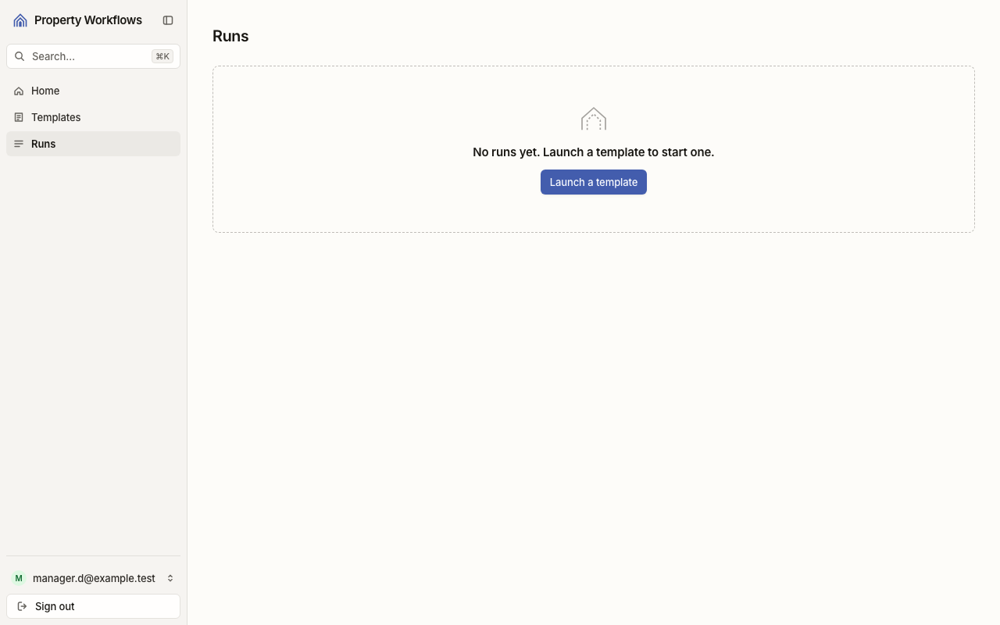

**Кроки:** ✔ Дано: менеджер B, у якого немає запусків → ✔ Коли: B відкриває список запусків → ✔ Тоді: B sees the message "No runs yet. Launch a template to start one." and the link "Launch a template", and no empty table.

**Агент (claude-haiku-5-5, PASS):** На кадрі сторінки /runs видно точний текст повідомлення та кнопку-посилання «Launch a template» під ним. Таблиці на кадрі немає, порожній контейнер-таблиця не видно. Кадр не показує, чи це саме тег a (посилання), бо елемент виглядає як кнопка; це не з кадрів. В лівому нижньому куті виведено акаунт manager.d@example.test, а в критерії йдеться про «manager B» — це стосується «Дано», яке я не оцінюю, але варто звірити, що тестовий акаунт справді без запусків.

**Цитати агента, звірені зі сторінкою (aria):**
- «No runs yet. Launch a template to start one.» — є на сторінці
- «Launch a template» — є на сторінці

**Правило:** R6: перевірки, агент і цитати збігаються

**Відео:** `test-results/artifacts/runs-empty-AC-DSYS-04-мене-14827-h-a-template»-і-без-таблиці-chromium/video.webm` · **траса:** `test-results/artifacts/runs-empty-AC-DSYS-04-мене-14827-h-a-template»-і-без-таблиці-chromium/trace.zip` (не в git)

**Рішення PM:** ☐ приймаю · ☐ відхилення від вимог (issue «Відхилення від вимог: AC-DSYS-04 — …») · @login: ____

## AC-EDITOR-07 — PASS

**Тест:** AC-EDITOR-07: менеджер B за прямим посиланням на список версій «Tenant move-in» бачить «Not enough rights» і жодної версії

**Критерій** (requirements/20-edit-a-template-with-version-control.md):

> AC-EDITOR-07: Given manager B signed in and the template "Tenant move-in" with versions 1 and 2. When B opens the list of versions of this template by a direct link. Then B sees the message "Not enough rights" and no versions.

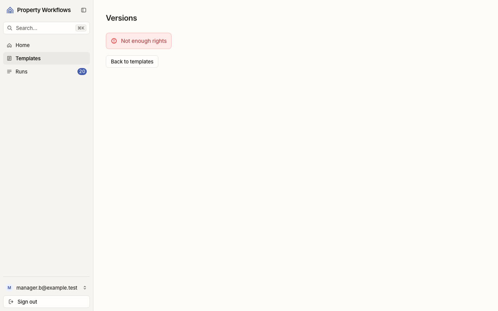

**Кроки:** ✔ Дано: менеджер B увійшов, шаблон «Tenant move-in» має версії 1 і 2 (перевірено під адміністратором) → ✔ Коли: B відкриває список версій цього шаблону за прямим посиланням → ✔ Тоді: B sees the message "Not enough rights" and no versions.

**Агент (claude-haiku-5-5, PASS):** На кадрі frame-then-1.png видно сторінку «Versions» з червоним повідомленням «Not enough rights», яке посимвольно збігається з критерієм. Список версій на кадрі відсутній, але відсутність версій належить до розділу «Не з кадрів» і тут не оцінювалась. Користувач увійшов як manager.b@example.test.

**Цитати агента, звірені зі сторінкою (aria):**
- «Not enough rights» — є на сторінці

**Правило:** R6: перевірки, агент і цитати збігаються

**Відео:** `test-results/artifacts/template-versions-forbidde-10b3c-ugh-rights»-і-жодної-версії-chromium/video.webm` · **траса:** `test-results/artifacts/template-versions-forbidde-10b3c-ugh-rights»-і-жодної-версії-chromium/trace.zip` (не в git)

**Рішення PM:** ☐ приймаю · ☐ відхилення від вимог (issue «Відхилення від вимог: AC-EDITOR-07 — …») · @login: ____

## AC-EDITOR-09 — PASS

**Тест:** AC-EDITOR-09: відвідувач без входу за прямим посиланням на редактор «Tenant move-in» бачить сторінку входу без вмісту шаблону

**Критерій** (requirements/20-edit-a-template-with-version-control.md):

> AC-EDITOR-09: Given a visitor who is not signed in. When the visitor opens the editor of the template "Tenant move-in" by a direct link. Then the visitor sees the sign-in page and no content of the template.

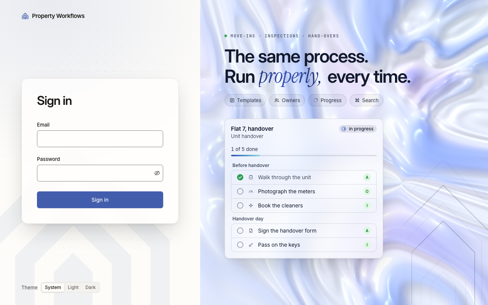

**Кроки:** ✔ Дано: відвідувач не увійшов → ✔ Коли: відвідувач відкриває редактор шаблону «Tenant move-in» за прямим посиланням → ✔ Тоді: the visitor sees the sign-in page and no content of the template.

**Агент (claude-haiku-5-5, PASS):** На кадрі видно сторінку входу з заголовком «Sign in», полями «Email» і «Password» та кнопкою «Sign in», кадр повний і читабельний. Праворуч є рекламна картка «Flat 7, handover» / «Unit handover», але це не назва шаблону «Tenant move-in», і відсутність вмісту шаблону перевіряють автоматично, тому це не оцінювалось.

**Цитати агента, звірені зі сторінкою (aria):**
- «Sign in» — є на сторінці
- «Email» — є на сторінці
- «Password» — є на сторінці
- «Sign in» — є на сторінці

**Правило:** R6: перевірки, агент і цитати збігаються

**Відео:** `test-results/artifacts/editor-visitor-AC-EDITOR-0-247c7-ку-входу-без-вмісту-шаблону-chromium/video.webm` · **траса:** `test-results/artifacts/editor-visitor-AC-EDITOR-0-247c7-ку-входу-без-вмісту-шаблону-chromium/trace.zip` (не в git)

**Рішення PM:** ☐ приймаю · ☐ відхилення від вимог (issue «Відхилення від вимог: AC-EDITOR-09 — …») · @login: ____

## AC-VENDOR-01 — PASS

**Тест:** AC-VENDOR-01: A запускає «Tenant move-in» для «Apartment 12, move-in» з V на задачах 3 і 4 — задачі 3 і 4 на V, 1, 2 і 5 на A

**Критерій** (requirements/39-assign-a-vendor-own-tasks.md):

> AC-VENDOR-01: Given manager A, vendor V and the template "Tenant move-in" with 5 tasks. When A launches the template for the case "Apartment 12, move-in" and assigns V as the assignee of tasks 3 and 4. Then tasks 3 and 4 have V as the assignee, and tasks 1, 2 and 5 have A.

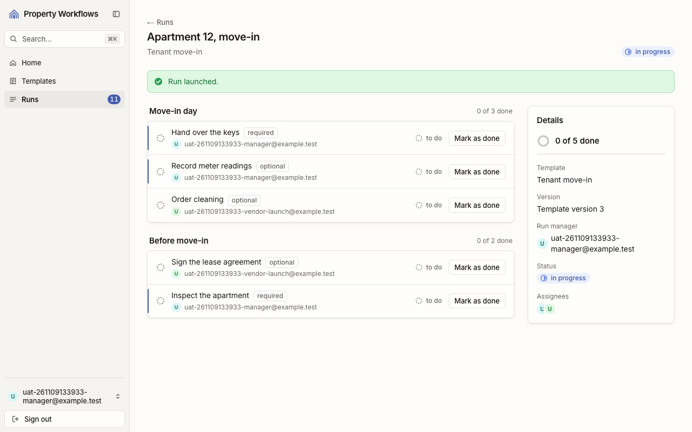

**Кроки:** ✔ Дано: менеджер A, підрядник V і шаблон «Tenant move-in» з 5 задачами → ✔ Коли: A запускає шаблон для випадку «Apartment 12, move-in» і призначає V виконавцем задач 3 і 4 → ✔ Тоді: tasks 3 and 4 have V as the assignee, and tasks 1, 2 and 5 have A.

**Агент (claude-haiku-5-5, PASS):** На кадрі сторінки запуску «Apartment 12, move-in» задачі «Order cleaning» і «Sign the lease agreement» мають виконавцем підрядника (vendor-launch), а «Hand over the keys», «Record meter readings» і «Inspect the apartment» — менеджера (manager). Порядок задач відповідає критерію: задачі 3 і 4 призначені V, а 1, 2 і 5 лишилися за A.

**Цитати агента, звірені зі сторінкою (aria):**
- «Order cleaning» — є на сторінці
- «uat-261109133933-vendor-launch@example.test» — є на сторінці
- «Sign the lease agreement» — є на сторінці
- «uat-261109133933-vendor-launch@example.test» — є на сторінці
- «Hand over the keys» — є на сторінці
- «uat-261109133933-manager@example.test» — є на сторінці
- «Record meter readings» — є на сторінці
- «uat-261109133933-manager@example.test» — є на сторінці
- «Inspect the apartment» — є на сторінці
- «uat-261109133933-manager@example.test» — є на сторінці

**Правило:** R6: перевірки, агент і цитати збігаються

**Відео:** `test-results/artifacts/vendor-Менеджер-A-признача-154c9-ачі-3-і-4-на-V-1-2-і-5-на-A-chromium/video.webm` · **траса:** `test-results/artifacts/vendor-Менеджер-A-признача-154c9-ачі-3-і-4-на-V-1-2-і-5-на-A-chromium/trace.zip` (не в git)

**Рішення PM:** ☐ приймаю · ☐ відхилення від вимог (issue «Відхилення від вимог: AC-VENDOR-01 — …») · @login: ____

## AC-VENDOR-02 — PASS

**Тест:** AC-VENDOR-02: A відкриває вибір виконавця — email B, адміністратора і V, без імен, ролей та інших даних профілю

**Критерій** (requirements/39-assign-a-vendor-own-tasks.md):

> AC-VENDOR-02: Given managers A and B, an administrator and vendor V, and A launching a template. When A opens the assignee picker. Then A sees the emails of B, of the administrator and of V, and no names, roles or other profile data.

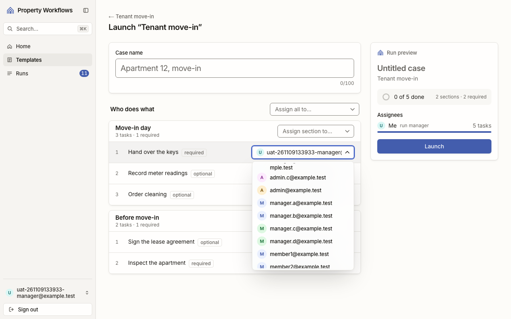
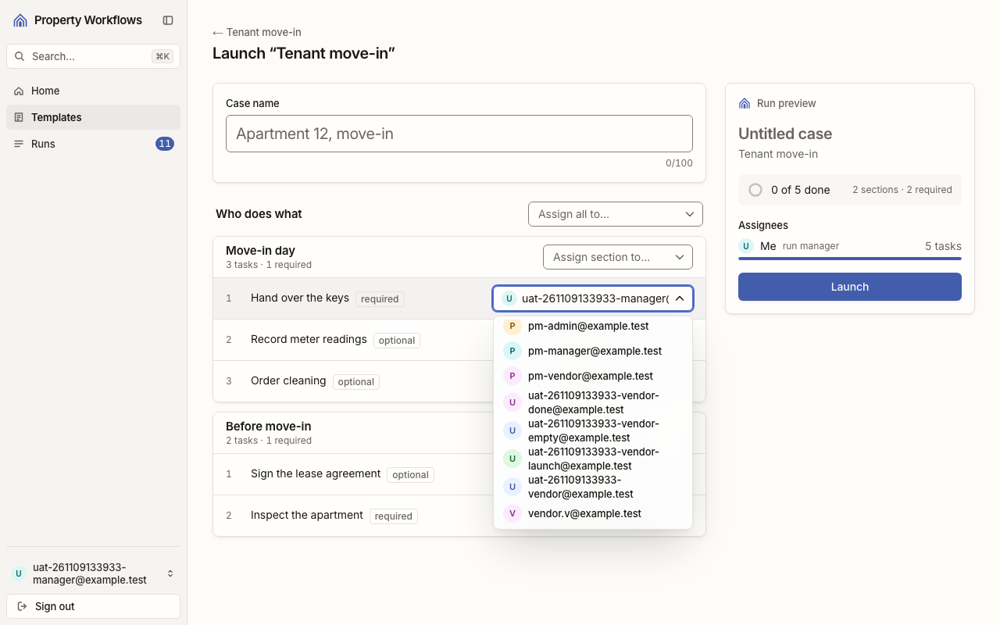

**Кроки:** ✔ Дано: менеджери A і B, адміністратор і підрядник V, і A запускає шаблон → ✔ Коли: A відкриває вибір виконавця → ✔ Тоді: A sees the emails of B, of the administrator and of V, and no names, roles or other profile data. → ✔ Тоді: A sees the emails of B, of the administrator and of V, and no names, roles or other profile data.

**Агент (claude-haiku-5-5, PASS):** На кадрі 1 у списку видно лише email-адреси, зокрема manager.b@example.test і admin@example.test, без імен і слів ролі поруч. На кадрі 2 видно uat-261109133933-vendor-launch@example.test (на екрані текст перенесено на два рядки через дефіс), а поруч також лише email, без імен і ролей. Частину про відсутність імен і ролей біля email V не оцінював, бо це поза кадрами.

**Цитати агента, звірені зі сторінкою (aria):**
- «manager.b@example.test» — є на сторінці
- «admin@example.test» — є на сторінці
- «uat-261109133933-vendor-launch@example.test» — є на сторінці

**Правило:** R6: перевірки, агент і цитати збігаються

**Відео:** `test-results/artifacts/vendor-Менеджер-A-признача-bb5cc-олей-та-інших-даних-профілю-chromium/video.webm` · **траса:** `test-results/artifacts/vendor-Менеджер-A-признача-bb5cc-олей-та-інших-даних-профілю-chromium/trace.zip` (не в git)

**Рішення PM:** ☐ приймаю · ☐ відхилення від вимог (issue «Відхилення від вимог: AC-VENDOR-02 — …») · @login: ____

## AC-VENDOR-03 — PASS

**Тест:** AC-VENDOR-03: V відкриває список запусків — лише «Apartment 12, move-in» зі статусом і «Your tasks: 0 of 2 done», без «Apartment 14, repair»

**Критерій** (requirements/39-assign-a-vendor-own-tasks.md):

> AC-VENDOR-03: Given vendor V who is the assignee of 2 tasks in the run "Apartment 12, move-in" and of no task in the run "Apartment 14, repair". When V opens the list of runs. Then V sees only the run "Apartment 12, move-in" with its run status and "Your tasks: 0 of 2 done", and does not see "Apartment 14, repair".

**Кроки:** ✔ Дано: V — виконавець 2 задач у «Apartment 12, move-in» і жодної в «Apartment 14, repair» → ✔ Коли: V відкриває список запусків → ✔ Тоді: V sees only the run "Apartment 12, move-in" with its run status and "Your tasks: 0 of 2 done", and does not see "Apartment 14, repair".

**Агент (claude-haiku-5-5, PASS):** На кадрі /runs видно один рядок «Apartment 12, move-in» з текстом «Your tasks: 0 of 2 done» і статусом «in progress». Усі три видимі частини «Тоді» підтверджені дослівно. Відсутність рядка «Apartment 14, repair» у розділі «Не з кадрів» не оцінювалася.

**Цитати агента, звірені зі сторінкою (aria):**
- «Apartment 12, move-in» — є на сторінці
- «in progress» — є на сторінці
- «Your tasks: 0 of 2 done» — є на сторінці

**Правило:** R6: перевірки, агент і цитати збігаються

**Відео:** `test-results/artifacts/vendor-Підрядник-V-із-зада-0f9b1-»-без-«Apartment-14-repair»-chromium/video.webm` · **траса:** `test-results/artifacts/vendor-Підрядник-V-із-зада-0f9b1-»-без-«Apartment-14-repair»-chromium/trace.zip` (не в git)

**Рішення PM:** ☐ приймаю · ☐ відхилення від вимог (issue «Відхилення від вимог: AC-VENDOR-03 — …») · @login: ____

## AC-VENDOR-04 — PASS

**Тест:** AC-VENDOR-04: V відкриває «Apartment 12, move-in» — рівно задачі 3 і 4 з назвою, секцією, «required»/«optional» і статусом; без задач 1, 2, 5, чужих email і прогресу всього запуску

**Критерій** (requirements/39-assign-a-vendor-own-tasks.md):

> AC-VENDOR-04: Given vendor V who is the assignee of tasks 3 and 4 in the run "Apartment 12, move-in" (5 tasks). When V opens this run. Then V sees exactly tasks 3 and 4, each with its name, its section, the mark "required" or "optional" and its status, and does not see tasks 1, 2 and 5, the emails of other users or the progress of the whole run.

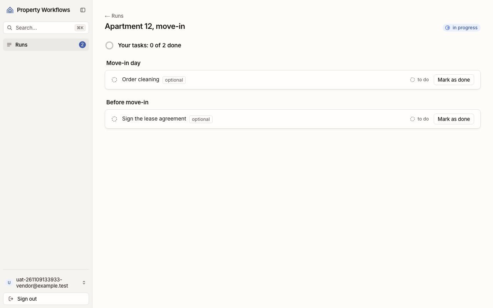

**Кроки:** ✔ Дано: V — виконавець задач 3 і 4 у запуску «Apartment 12, move-in» з 5 задачами → ✔ Коли: V відкриває цей запуск → ✔ Тоді: V sees exactly tasks 3 and 4, each with its name, its section, the mark "required" or "optional" and its status, and does not see tasks 1, 2 and 5, the emails of other users or the progress of the whole run.

**Агент (claude-haiku-5-5, PASS):** На кадрі frame-then-1.png видно дві задачі: «Order cleaning» у секції «Move-in day» і «Sign the lease agreement» у секції «Before move-in», обидві з позначкою «optional» і статусом «to do». Заголовок «Your tasks: 0 of 2 done» показує лише задачі виконавця, загального прогресу запуску на кадрі немає. Частини з розділу «Не з кадрів» не оцінював.

**Цитати агента, звірені зі сторінкою (aria):**
- «Move-in day» — є на сторінці
- «Order cleaning» — є на сторінці
- «optional» — є на сторінці
- «to do» — є на сторінці
- «Before move-in» — є на сторінці
- «Sign the lease agreement» — є на сторінці
- «optional» — є на сторінці
- «to do» — є на сторінці

**Правило:** R6: перевірки, агент і цитати збігаються

**Відео:** `test-results/artifacts/vendor-Підрядник-V-із-зада-21104-l-і-прогресу-всього-запуску-chromium/video.webm` · **траса:** `test-results/artifacts/vendor-Підрядник-V-із-зада-21104-l-і-прогресу-всього-запуску-chromium/trace.zip` (не в git)

**Рішення PM:** ☐ приймаю · ☐ відхилення від вимог (issue «Відхилення від вимог: AC-VENDOR-04 — …») · @login: ____

## AC-VENDOR-05 — PASS

**Тест:** AC-VENDOR-05: V позначає свою задачу 3 «done» — задача 3 «done», «Your tasks: 1 of 2 done»

**Критерій** (requirements/39-assign-a-vendor-own-tasks.md):

> AC-VENDOR-05: Given vendor V who is the assignee of task 3 with status "to do", which is not the last required task of the run "Apartment 12, move-in". When V marks task 3 as done. Then task 3 has status "done", and V sees "Your tasks: 1 of 2 done".

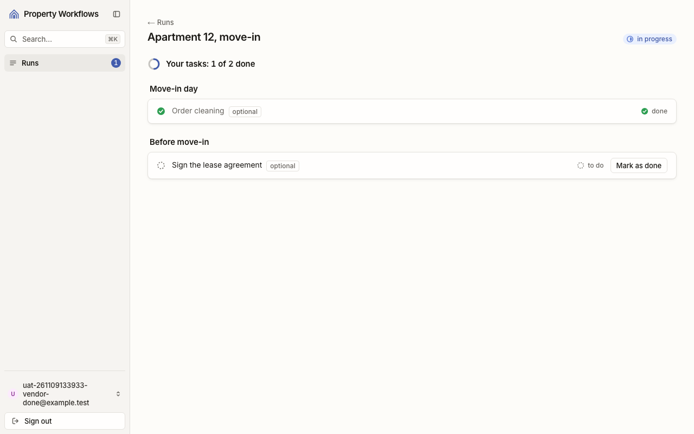

**Кроки:** ✔ Дано: V — виконавець задачі 3 зі статусом «to do», яка не є останньою обов'язковою задачею запуску → ✔ Коли: V позначає задачу 3 виконаною → ✔ Тоді: task 3 has status "done", and V sees "Your tasks: 1 of 2 done".

**Агент (claude-haiku-5-5, PASS):** На кадрі frame-then-1.png у розділі «Move-in day» задача «Order cleaning» позначена зеленою галочкою і статусом «done». Угорі написано «Your tasks: 1 of 2 done», що збігається з критерієм посимвольно. Задача «Sign the lease agreement» показана як «to do», але це не видима частина «Тоді» для оцінки.

**Цитати агента, звірені зі сторінкою (aria):**
- «Order cleaning» — є на сторінці
- «done» — є на сторінці
- «Your tasks: 1 of 2 done» — є на сторінці

**Правило:** R6: перевірки, агент і цитати збігаються

**Відео:** `test-results/artifacts/vendor-Підрядник-V-познача-f5b68-e»-«Your-tasks-1-of-2-done»-chromium/video.webm` · **траса:** `test-results/artifacts/vendor-Підрядник-V-познача-f5b68-e»-«Your-tasks-1-of-2-done»-chromium/trace.zip` (не в git)

**Рішення PM:** ☐ приймаю · ☐ відхилення від вимог (issue «Відхилення від вимог: AC-VENDOR-05 — …») · @login: ____

## AC-VENDOR-06 — PASS

**Тест:** AC-VENDOR-06: V за прямим посиланням на «Apartment 14, repair» — «Run not found» і жодної задачі

**Критерій** (requirements/39-assign-a-vendor-own-tasks.md):

> AC-VENDOR-06: Given the run "Apartment 14, repair" in which vendor V has no task. When V opens the page of this run by a direct link. Then V sees the message "Run not found" and none of the tasks of the run.

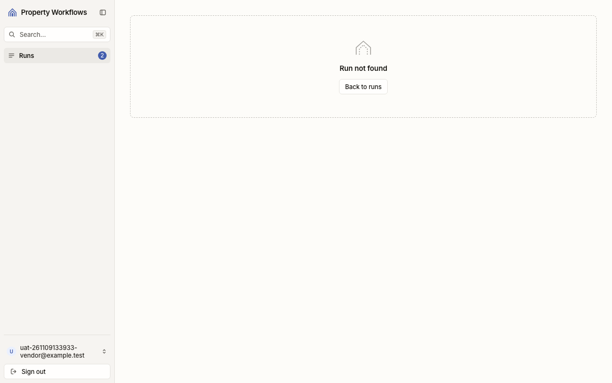

**Кроки:** ✔ Дано: запуск «Apartment 14, repair», у якому підрядник V не має задач → ✔ Коли: V відкриває сторінку цього запуску за прямим посиланням → ✔ Тоді: V sees the message "Run not found" and none of the tasks of the run.

**Агент (claude-haiku-5-5, PASS):** На кадрі видно великий напис «Run not found» у порожньому пунктирному блоці з кнопкою «Back to runs». Жодного рядка задачі чи секції запуску на екрані немає; бічна панель показує лише «Runs» з лічильником 2, що не є частиною запуску.

**Цитати агента, звірені зі сторінкою (aria):**
- «Run not found» — є на сторінці

**Правило:** R6: перевірки, агент і цитати збігаються

**Відео:** `test-results/artifacts/vendor-Підрядник-V-із-зада-fd1a0--not-found»-і-жодної-задачі-chromium/video.webm` · **траса:** `test-results/artifacts/vendor-Підрядник-V-із-зада-fd1a0--not-found»-і-жодної-задачі-chromium/trace.zip` (не в git)

**Рішення PM:** ☐ приймаю · ☐ відхилення від вимог (issue «Відхилення від вимог: AC-VENDOR-06 — …») · @login: ____

## AC-VENDOR-07 — PASS

**Тест:** AC-VENDOR-07: V напряму позначає задачу 1 менеджера A — задача 1 лишається «to do»

**Критерій** (requirements/39-assign-a-vendor-own-tasks.md):

> AC-VENDOR-07: Given the run "Apartment 12, move-in" in which task 1 is assigned to manager A and tasks 3 and 4 to vendor V. When V tries to mark task 1 as done directly, bypassing the pages of the application. Then task 1 stays "to do".

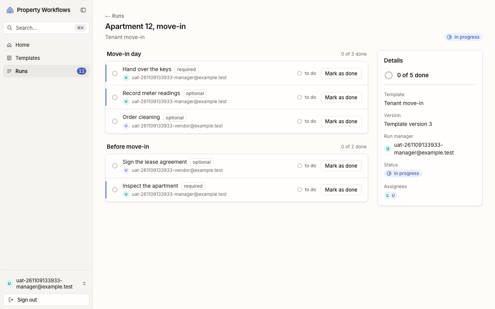

**Кроки:** ✔ Дано: запуск «Apartment 12, move-in»: задача 1 — на менеджері A, задачі 3 і 4 — на підряднику V → ✔ Коли: V намагається позначити задачу 1 виконаною напряму, оминаючи сторінки застосунку → ✔ Тоді: task 1 stays "to do".

**Агент (claude-haiku-5-5, PASS):** На кадрі сторінка «Apartment 12, move-in» з заголовком запуску та вхід під менеджером (uat-261109133933-manager@example.test). Задача «Hand over the keys» має статус «to do» і кнопку «Mark as done», тобто залишилася невиконаною. Частина про відхилений прямий запит підрядника (NOT_ALLOWED) не з кадрів, тому не оцінювалася.

**Цитати агента, звірені зі сторінкою (aria):**
- «Hand over the keys» — є на сторінці
- «to do» — є на сторінці

**Правило:** R6: перевірки, агент і цитати збігаються

**Відео:** `test-results/artifacts/vendor-Підрядник-V-із-зада-f3689--задача-1-лишається-«to-do»-chromium/video.webm` · **траса:** `test-results/artifacts/vendor-Підрядник-V-із-зада-f3689--задача-1-лишається-«to-do»-chromium/trace.zip` (не в git)

**Рішення PM:** ☐ приймаю · ☐ відхилення від вимог (issue «Відхилення від вимог: AC-VENDOR-07 — …») · @login: ____

## AC-VENDOR-08 — PASS

**Тест:** AC-VENDOR-08: V за прямим посиланням на список шаблонів — «Not enough rights» і жодного шаблону

**Критерій** (requirements/39-assign-a-vendor-own-tasks.md):

> AC-VENDOR-08: Given vendor V signed in. When V opens the list of templates by a direct link. Then V sees the message "Not enough rights" and no template.

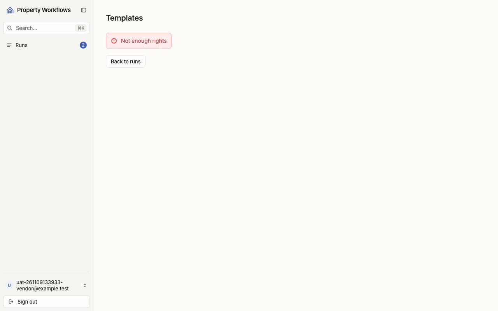

**Кроки:** ✔ Дано: підрядник V, який увійшов → ✔ Коли: V відкриває список шаблонів за прямим посиланням → ✔ Тоді: V sees the message "Not enough rights" and no template.

**Агент (claude-haiku-5-5, PASS):** На кадрі frame-then-1.png (сторінка Templates) видно червоне повідомлення «Not enough rights», яке збігається з критерієм посимвольно. Список шаблонів на кадрі не відображається, але частину «жодного шаблону» оцінити з кадрів не можна, її перевіряють автоматичні перевірки.

**Цитати агента, звірені зі сторінкою (aria):**
- «Not enough rights» — є на сторінці

**Правило:** R6: перевірки, агент і цитати збігаються

**Відео:** `test-results/artifacts/vendor-Підрядник-V-із-зада-ee579-h-rights»-і-жодного-шаблону-chromium/video.webm` · **траса:** `test-results/artifacts/vendor-Підрядник-V-із-зада-ee579-h-rights»-і-жодного-шаблону-chromium/trace.zip` (не в git)

**Рішення PM:** ☐ приймаю · ☐ відхилення від вимог (issue «Відхилення від вимог: AC-VENDOR-08 — …») · @login: ____

## AC-VENDOR-09 — PASS

**Тест:** AC-VENDOR-09: V напряму запускає «Tenant move-in» — запуск не створено, список запусків не змінився

**Критерій** (requirements/39-assign-a-vendor-own-tasks.md):

> AC-VENDOR-09: Given vendor V signed in and the template "Tenant move-in" with current version 1. When V tries to launch this template directly, bypassing the pages of the application. Then no run is created, and the list of runs does not change.

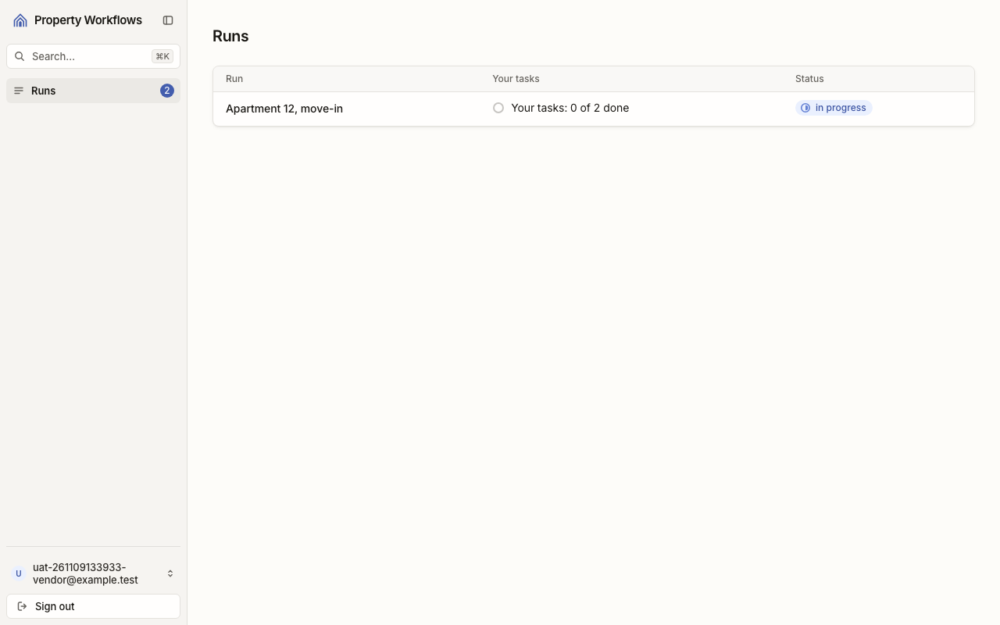

**Кроки:** ✔ Дано: підрядник V, який увійшов, і шаблон «Tenant move-in» з поточною версією → ✔ Коли: V намагається запустити цей шаблон напряму, оминаючи сторінки застосунку → ✔ Тоді: no run is created, and the list of runs does not change.

**Агент (claude-haiku-5-5, PASS):** На сторінці /runs видно один рядок запуску «Apartment 12, move-in» зі статусом in progress, і це збігається з очікуваним списком. Кадр показує лише стан після запиту, тому порівняння з «до запиту» спирається на опис критерію; бейдж «2» біля Runs пояснюється написом «Your tasks: 0 of 2 done» і не свідчить про інший запуск.

**Цитати агента, звірені зі сторінкою (aria):**
- «Apartment 12, move-in» — є на сторінці

**Правило:** R6: перевірки, агент і цитати збігаються

**Відео:** `test-results/artifacts/vendor-Підрядник-V-із-зада-54d03-список-запусків-не-змінився-chromium/video.webm` · **траса:** `test-results/artifacts/vendor-Підрядник-V-із-зада-54d03-список-запусків-не-змінився-chromium/trace.zip` (не в git)

**Рішення PM:** ☐ приймаю · ☐ відхилення від вимог (issue «Відхилення від вимог: AC-VENDOR-09 — …») · @login: ____

## AC-VENDOR-10 — PASS

**Тест:** AC-VENDOR-10: V без задач відкриває список запусків — «No tasks assigned to you yet.» без порожньої таблиці

**Критерій** (requirements/39-assign-a-vendor-own-tasks.md):

> AC-VENDOR-10: Given vendor V to whom no task is assigned. When V opens the list of runs. Then V sees the message "No tasks assigned to you yet." and no empty table.

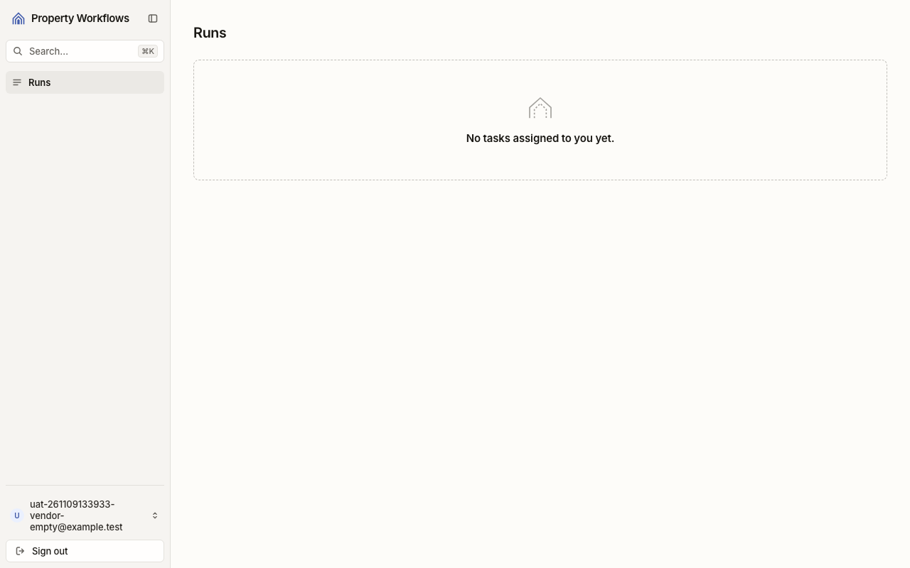

**Кроки:** ✔ Дано: підрядник V, якому не призначено жодної задачі → ✔ Коли: V відкриває список запусків → ✔ Тоді: V sees the message "No tasks assigned to you yet." and no empty table.

**Агент (claude-haiku-5-5, PASS):** На кадрі сторінки «Runs» у порожньому пунктирному блоці видно напис «No tasks assigned to you yet.», він збігається з критерієм посимвольно. Таблиці з рядками на кадрі не видно, але перевірка порожньої таблиці віднесена до автоматичних перевірок і тут не оцінюється.

**Цитати агента, звірені зі сторінкою (aria):**
- «No tasks assigned to you yet.» — є на сторінці

**Правило:** R6: перевірки, агент і цитати збігаються

**Відео:** `test-results/artifacts/vendor-Підрядник-V-без-зад-ae071-yet-»-без-порожньої-таблиці-chromium/video.webm` · **траса:** `test-results/artifacts/vendor-Підрядник-V-без-зад-ae071-yet-»-без-порожньої-таблиці-chromium/trace.zip` (не в git)

**Рішення PM:** ☐ приймаю · ☐ відхилення від вимог (issue «Відхилення від вимог: AC-VENDOR-10 — …») · @login: ____

## Як читати підсумок

- **PASS** — автоматичні перевірки пройшли, агент-рецензент погодився з кадром, а кожну його цитату знайдено на сторінці.
- **FAIL** — впала автоматична перевірка. Агент цього не перекриває: невидимі вади (буфер обміну, база) він на кадрі не побачить.
- **NEEDS-HUMAN** — перевірки зелені, але агент не погодився або його цитати немає на сторінці. Часто це слабкий тест або розбіжність між текстом AC і тестом — питання до PM, а не обов'язково вада продукту.

Правила: R1: перевірка впала — FAIL завжди, агент не перекриває; R2: немає вердикту агента або кадру; R3: перевірки пройшли, агент не погоджується — вирішує людина; R4: цитати агента немає на сторінці (aria) — не підтверджено; R5: помилка сторінки або 5xx під час сценарію; R6: перевірки, агент і цитати збігаються.
