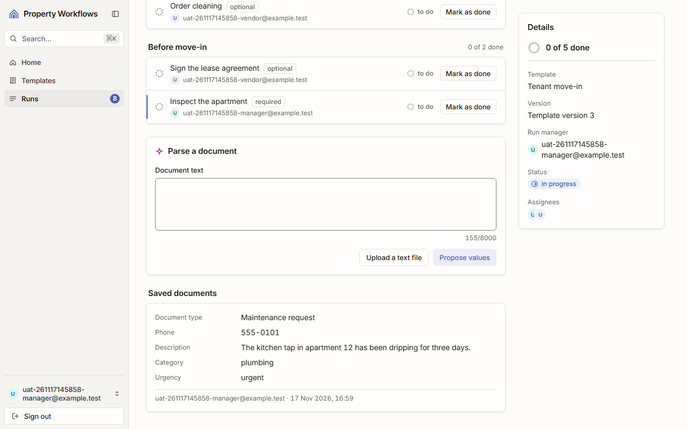
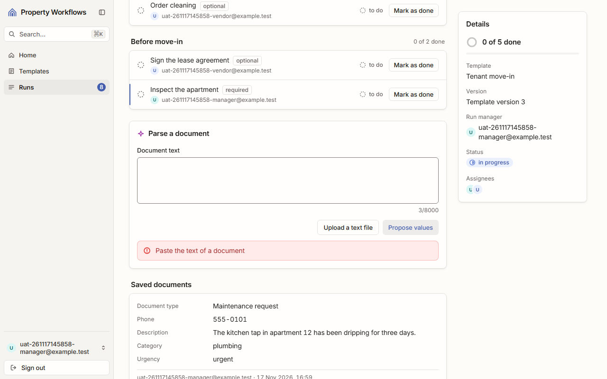
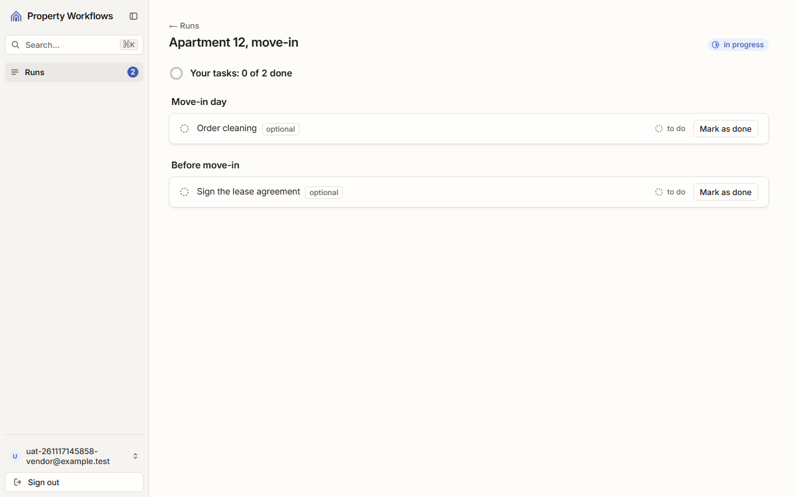

# Звіт UAT — 17.11.2026

- **Застосунок:** https://property-workflows-rho.vercel.app (/api/health: коміт `5d6e522`)
- **Код тестів:** `task/uat-docai-04-assert` @ `5d6e522` + незакомічені зміни
- **Прогін:** 17.11.2026, 16:58 (Київ), Playwright 52.6 с; AC: 3 — PASS 3, FAIL 0, NEEDS-HUMAN 0
- **Рецензент:** `claude-haiku-5-5`; суперечки → `claude-sonnet-5-5`. Разом за розбір: $0.0367 (ціни API; за підпискою — у межах ліміту плану)
- **Прибирання:** синтетичних uat-*@example.test видалено 5, лишилось 0, їхніх рядків, що лишились: 0
- **Відео й траси:** не в git — `test-results/` локально або артефакт CI; трасу відкриває `npx playwright show-trace <trace.zip>`

| AC | Перевірки | Агент | Підсумок | Чому | Playwright | Розбір |
|---|---|---|---|---|---|---|
| AC-DOCAI-04 | пройшли | Haiku: PASS | **PASS** | R6: перевірки, агент і цитати збігаються | 15.8 с | $0.0024, 9.2 с |
| AC-DOCAI-11 | пройшли | Haiku: NEEDS-HUMAN, Sonnet: PASS | **PASS** | R6: перевірки, агент і цитати збігаються | 5.0 с | $0.0321, 19.4 с |
| AC-DOCAI-14 | пройшли | Haiku: PASS | **PASS** | R6: перевірки, агент і цитати збігаються | 2.1 с | $0.0022, 8.5 с |

## AC-DOCAI-04 — PASS

**Тест:** AC-DOCAI-04: A змінює Urgency на «urgent» і обирає «Save values» — на сторінці запуску один збережений запис з email A і часом

**Критерій** (requirements/59-parse-a-document-and-confirm-the-values.md):

> AC-DOCAI-04: Given run manager A with Document type "Maintenance request", Phone "555-0101", Category "plumbing" and Urgency "not urgent" proposed in the block. When A changes Urgency to "urgent" and chooses "Save values". Then the page of the run shows one saved record with Document type "Maintenance request", Phone "555-0101", Category "plumbing" and Urgency "urgent", the email of A and the date and time of the confirmation.

**Кроки:** ✔ Дано: менеджер A на сторінці запуску, у блоці запропоновано Document type «Maintenance request», Phone «555-0101», Category «plumbing» і Urgency «not urgent» → ✔ Коли: A змінює Urgency на «urgent» і обирає «Save values» → ✔ Тоді: the page of the run shows one saved record with Document type "Maintenance request", Phone "555-0101", Category "plumbing" and Urgency "urgent", the email of A and the date and time of the confirmation.

**Агент (claude-haiku-5-5, PASS):** На кадрі в розділі «Saved documents» видно один запис із Document type «Maintenance request», Phone «555-0101», Category «plumbing» і Urgency «urgent». Унизу запису підпис «uat-261117145858-manager@example.test · 17 Nov 2026, 16:59», тож email A і дата з часом видимі. Запис також містить поле Description, якого в критерії немає; критерій його не забороняє, тому це не вада.

**Цитати агента, звірені зі сторінкою (aria):**
- «Saved documents» — є на сторінці
- «Document type» — є на сторінці
- «Maintenance request» — є на сторінці
- «Phone» — є на сторінці
- «555-0101» — є на сторінці
- «Category» — є на сторінці
- «plumbing» — є на сторінці
- «Urgency» — є на сторінці
- «urgent» — є на сторінці
- «uat-261117145858-manager@example.test» — є на сторінці
- «17 Nov 2026, 16:59» — є на сторінці

**Правило:** R6: перевірки, агент і цитати збігаються

**Відео:** `test-results/artifacts/docai-Менеджер-A-на-сторін-a7dd9-ний-запис-з-email-A-і-часом-chromium/video.webm` · **траса:** `test-results/artifacts/docai-Менеджер-A-на-сторін-a7dd9-ний-запис-з-email-A-і-часом-chromium/trace.zip` (не в git)

**Рішення PM:** ☐ приймаю · ☐ відхилення від вимог (issue «Відхилення від вимог: AC-DOCAI-04 — …») · @login: ____

## AC-DOCAI-11 — PASS

**Тест:** AC-DOCAI-11: A обирає «Propose values» з порожнім текстом — блок показує «Paste the text of a document», значень немає

**Критерій** (requirements/59-parse-a-document-and-confirm-the-values.md):

> AC-DOCAI-11: Given run manager A with an empty text box or only spaces in it. When A chooses "Propose values". Then the block shows "Paste the text of a document" and no value is proposed.

**Кроки:** ✔ Дано: менеджер A на сторінці запуску з текстом лише з пробілів → ✔ Коли: A обирає «Propose values» → ✔ Тоді: the block shows "Paste the text of a document" and no value is proposed.

**Агент (claude-sonnet-5-5, PASS):** У блоці «Parse a document» поле тексту порожнє на вигляд (лічильник 3/8000, тобто лише пробіли), під кнопками червоне повідомлення «Paste the text of a document». Форми «Values» з пропозицією AI у блоці немає; нижче лише раніше збережений документ в «Saved documents».

Haiku сказав NEEDS-HUMAN, тож розбір повторив Sonnet; рішення агента — за Sonnet.

**Цитати агента, звірені зі сторінкою (aria):**
- «Paste the text of a document» — є на сторінці
- «Parse a document» — є на сторінці

**Правило:** R6: перевірки, агент і цитати збігаються

**Відео:** `test-results/artifacts/docai-Менеджер-A-на-сторін-1a07a-f-a-document»-значень-немає-chromium/video.webm` · **траса:** `test-results/artifacts/docai-Менеджер-A-на-сторін-1a07a-f-a-document»-значень-немає-chromium/trace.zip` (не в git)

**Рішення PM:** ☐ приймаю · ☐ відхилення від вимог (issue «Відхилення від вимог: AC-DOCAI-11 — …») · @login: ____

## AC-DOCAI-14 — PASS

**Тест:** AC-DOCAI-14: V відкриває сторінку запуску «Apartment 12, move-in» — блоку «Parse a document» немає

**Критерій** (requirements/59-parse-a-document-and-confirm-the-values.md):

> AC-DOCAI-14: Given vendor V who is the assignee of tasks 3 and 4 in the run "Apartment 12, move-in". When V opens the page of this run. Then V does not see the block "Parse a document".

**Кроки:** ✔ Дано: підрядник V — виконавець задач 3 і 4 у запуску «Apartment 12, move-in» → ✔ Коли: V відкриває сторінку цього запуску → ✔ Тоді: V does not see the block "Parse a document".

**Агент (claude-haiku-5-5, PASS):** На кадрі видно сторінку запуску «Apartment 12, move-in» з блоками «Move-in day» і «Before move-in», блоку «Parse a document» немає, сторінка повністю відрисована без ознак завантаження. Кадр не показує номери задач, тому те, що V є виконавцем задач 3 і 4, з кадру не перевірити; це частина «Дано», а не «Тоді».

**Цитати агента, звірені зі сторінкою (aria):**
- «Apartment 12, move-in» — є на сторінці

**Правило:** R6: перевірки, агент і цитати збігаються

**Відео:** `test-results/artifacts/docai-Підрядник-V-із-задач-4d6e9-ку-«Parse-a-document»-немає-chromium/video.webm` · **траса:** `test-results/artifacts/docai-Підрядник-V-із-задач-4d6e9-ку-«Parse-a-document»-немає-chromium/trace.zip` (не в git)

**Рішення PM:** ☐ приймаю · ☐ відхилення від вимог (issue «Відхилення від вимог: AC-DOCAI-14 — …») · @login: ____

## Як читати підсумок

- **PASS** — автоматичні перевірки пройшли, агент-рецензент погодився з кадром, а кожну його цитату знайдено на сторінці.
- **FAIL** — впала автоматична перевірка. Агент цього не перекриває: невидимі вади (буфер обміну, база) він на кадрі не побачить.
- **NEEDS-HUMAN** — перевірки зелені, але агент не погодився або його цитати немає на сторінці. Часто це слабкий тест або розбіжність між текстом AC і тестом — питання до PM, а не обов'язково вада продукту.

Правила: R1: перевірка впала — FAIL завжди, агент не перекриває; R2: немає вердикту агента або кадру; R3: перевірки пройшли, агент не погоджується — вирішує людина; R4: цитати агента немає на сторінці (aria) — не підтверджено; R5: помилка сторінки або 5xx під час сценарію; R6: перевірки, агент і цитати збігаються.
